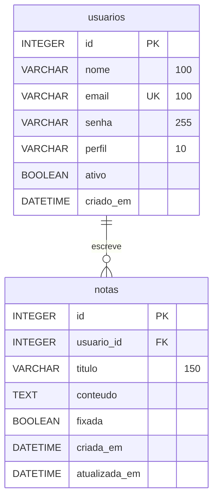

# MyNotes

Bloco de notas pessoal na web, feito por Nicholas Reis e Raul. Cada usuário cria uma conta e gerencia as próprias notas, e um administrador gerencia as contas.

**Tecnologias:** Python 3.12 ou superior, Flask, SQLAlchemy, SQLite, Jinja2 e Bootstrap 5.

## Instalação

Execute os comandos dentro desta pasta.

Windows (PowerShell):

```powershell
py -m venv .venv
.venv\Scripts\python -m pip install -r requirements.txt
```

Linux ou macOS:

```bash
python3 -m venv .venv
.venv/bin/python -m pip install -r requirements.txt
```

## Execução

Windows:

```powershell
.venv\Scripts\python run.py
```

Linux ou macOS:

```bash
.venv/bin/python run.py
```

Acesse <http://127.0.0.1:5000>. A aplicação atende apenas na máquina local. As páginas carregam o Bootstrap por CDN, então o navegador precisa de internet.

Se o banco não existir, `run.py` cria as tabelas e insere os dados de exemplo. Para voltar aos dados iniciais, **apagando tudo**, pare a aplicação e execute `criar_banco.py --recriar` com o mesmo Python do ambiente virtual.

## Contas de exemplo

| Perfil | E-mail | Senha |
|---|---|---|
| Administrador | `admin@mynotes.local` | `Admin@2026` |
| Usuário | `ana@mynotes.local` | `Ana@2026!` |
| Usuário | `bruno@mynotes.local` | `Bruno@2026` |
| Usuário bloqueado | `carla@mynotes.local` | `Carla@2026` |

## Estrutura de pastas

```text
mynotes/
├── run.py                 inicia a aplicação
├── criar_banco.py         cria as tabelas e insere os dados de exemplo
├── config.py              configurações e caminho do banco
├── requirements.txt       dependências
├── database/
│   └── mynotes.db         banco SQLite
└── app/
    ├── __init__.py        cria a aplicação Flask
    ├── extensions.py      conexão com o banco e proteção CSRF
    ├── sessao.py          sessão e controle de acesso
    ├── validacao.py       validação dos formulários
    ├── models/            mapeamento objeto-relacional
    │   ├── usuario.py     tabela usuarios
    │   └── nota.py        tabela notas
    ├── routes/            rotas, um blueprint por assunto
    │   ├── auth.py
    │   ├── notas.py
    │   ├── perfil.py
    │   └── admin.py
    ├── templates/         páginas Jinja2
    └── static/            CSS e JavaScript
```

## Conexão com o banco

O caminho do SQLite fica em `config.py` e a conexão em `app/extensions.py`, pelo Flask-SQLAlchemy. O `PRAGMA foreign_keys` é ligado em cada conexão, pois sem ele o SQLite ignora o `ON DELETE CASCADE`.

## Mapeamento objeto-relacional



## Rotas

| Método | Rota | Requisito | Acesso |
|---|---|---|---|
| GET, POST | `/cadastro` | RF01 | Visitante |
| GET, POST | `/login` | RF02 | Visitante |
| POST | `/logout` | RF02 | Usuário |
| GET, POST | `/perfil` | RF03 | Usuário |
| POST | `/perfil/senha` | RF03 | Usuário |
| GET, POST | `/notas/nova` | RF04 | Usuário |
| GET | `/` | RF05 | Usuário |
| GET | `/notas/<id>` | RF06 | Dono da nota |
| GET, POST | `/notas/<id>/editar` | RF07 | Dono da nota |
| POST | `/notas/<id>/excluir` | RF07 | Dono da nota |
| GET | `/?q=palavra` | RF08 | Usuário |
| POST | `/notas/<id>/fixar` | RF09 | Dono da nota |
| GET | `/admin/usuarios` | RF10 | Administrador |
| POST | `/admin/usuarios/<id>/bloquear` | RF10 | Administrador |
| POST | `/admin/usuarios/<id>/excluir` | RF10 | Administrador |

A rota `bloquear` alterna entre bloquear e desbloquear. O administrador não pode bloquear nem excluir a própria conta.
